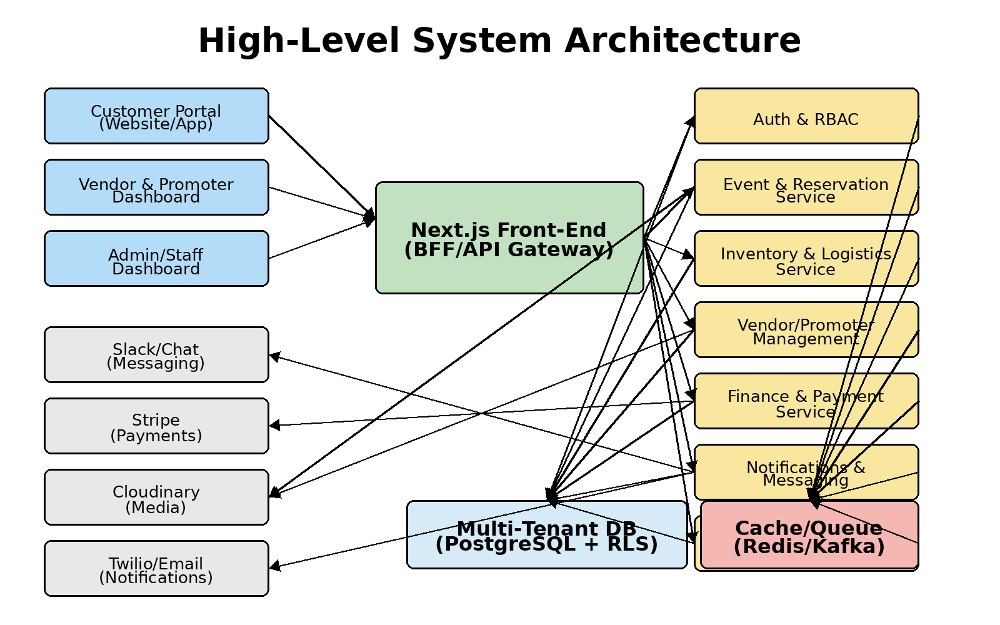

# System Architecture & Roadmap (Afrobeat Lounge Platform)

## Overview
This platform combines a **customer-first** nightlife website with a **multi-location** business management backend operated by the lounge’s own team. Guests can browse galleries, see upcoming events with countdowns, reserve sections and pay deposits, and request $5 DJ shout-outs. The backend lets admins manage events, inventory, contracts, vendors/promoters, accounting, budgeting, messaging, and reporting for each lounge location. Promoters and vendors get their own dashboards (contracts, payments, messaging, meetings) without exposing the system as a public SaaS product.

## Diagrams
The images below are included in this ZIP and referenced by relative paths so they render when you open this README locally.

## Tech Stack (recommended)
- **Next.js 15 + TypeScript** (App Router), **Tailwind CSS**, **shadcn/ui** for fast, accessible UI.
- **Auth.js or Clerk** for location-aware auth & RBAC.
- **PostgreSQL** with **Row-Level Security** (RLS) for location isolation; **Prisma** or **Drizzle ORM**.
- **Redis** (cache, queues). **tRPC/Route Handlers** as the BFF/API gateway.
- **Stripe** (deposits, tickets, invoices), **Cloudinary** (media), **Twilio/Email/Slack** (notifications).
- Deploy on **Vercel/AWS/Supabase**; use **CDN + Edge** for low latency.

## Key Features to Implement
- **Customer site**: galleries, services, event list with countdown, section reservations, playlists, shout-outs.
- **Promoter/Vendor portal**: contracts & signatures, payouts/receipts, messaging, scheduling.
- **Admin**: theme/site config, contract templates, inventory & vendors, budge/accounting, events, CS inbox, payroll, records, reports, audits, notifications and SLA handling.
- **Event policy**: Free entry by default; **ticketed** special events are pre-paid online to avoid lines at the door.

## Roadmap (high-level)
1. **Discovery** → user journeys, data model, location routing style (subdomain vs path).
2. **Design** → mobile‑first, dark mode, accessible UI; component library; micro‑interactions.
3. **MVP** → customer flows (events/reservations/shout-outs), promoter onboarding, admin basics.
4. **Backoffice** → inventory, contracts, finance, CRM/CS inbox, notifications.
5. **Scale** → RUM monitoring, performance budgets, horizontal scaling, cost observability.

---

> Questions or edits? Update this README and re-export the diagrams as needed. Both images live in `public/` and are referenced with relative paths.

## Architecture deltas to address

The comprehensive README outlines additional objectives and operational guardrails that are not yet reflected in this condensed architecture summary. Update the diagrams and supporting documentation to cover the following gaps:

- **Marketing & promoter collaboration** – add campaign management, promoter partnership tooling and analytics pathways called out as differentiators for the lounge experience.【F:README.md†L8-L13】【F:README.md†L56-L64】
- **Curated content services** – highlight playlist curation and DJ shout-out payment flows (with Stripe) so they are treated as first-class services in the system diagrams.【F:README.md†L8-L13】【F:README.md†L136-L144】
- **Operational automation & observability** – incorporate automated location provisioning, CI/CD, monitoring, logging and alerting strategies recommended for the lounge’s multi-location operations platform.【F:README.md†L78-L113】【F:README.md†L204-L213】
- **Data lifecycle management** – show backup, migration and recovery processes to satisfy the location data retention expectations.【F:README.md†L106-L113】
- **AI-powered personalisation** – reserve space in the roadmap for the AI recommendations and chatbot initiatives described as future enhancements.【F:README.md†L226-L231】
- **Edge performance & accessibility** – reflect low-latency delivery (CDN/edge) and accessibility mandates that shape front-end architecture decisions.【F:README.md†L24-L55】【F:README.md†L168-L176】

Documenting these elements keeps the living architecture aligned with the product vision and ensures downstream teams design against the same set of priorities.

---

> For the end-to-end delivery plans, milestones and verification checklists that align the architecture with the README objectives, see `project_plan.md`.
