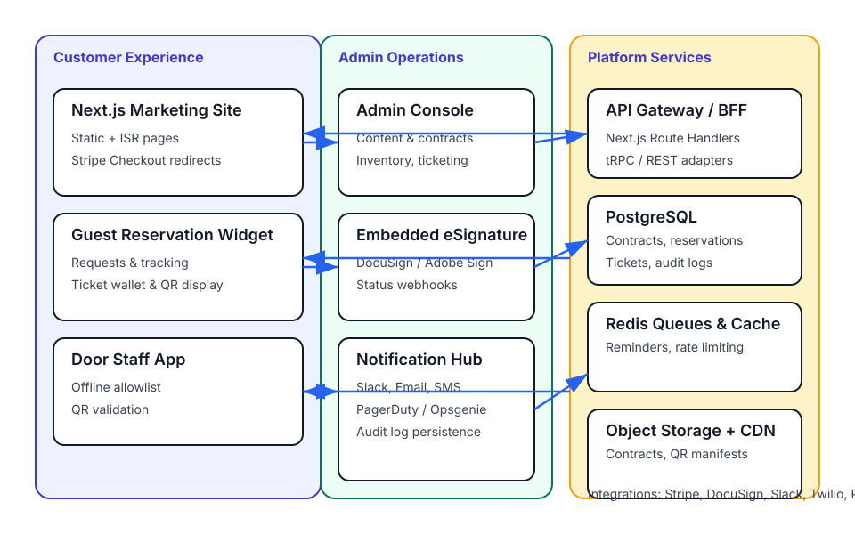
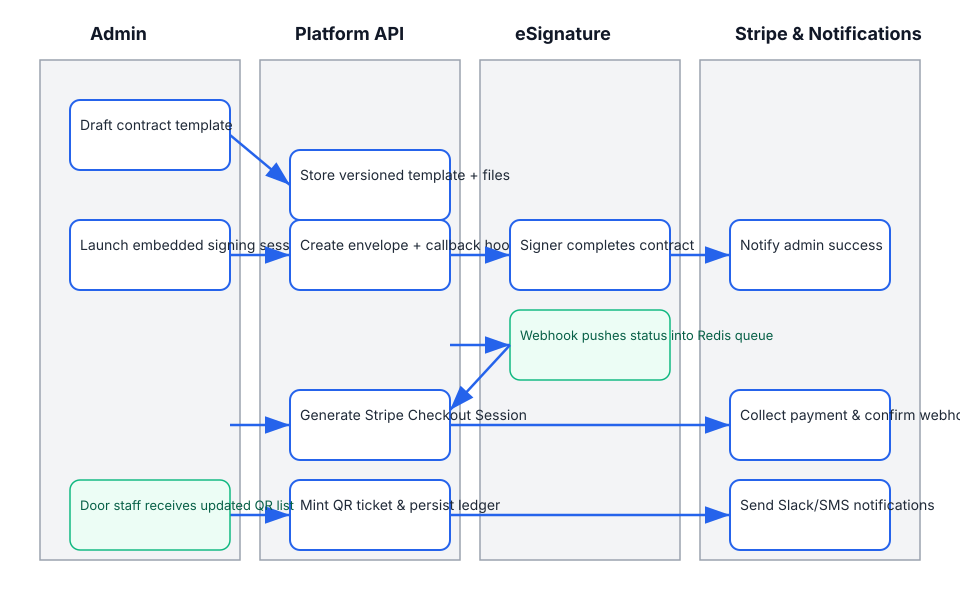

# System Architecture & Roadmap (Afrobeat Lounge Platform)

## Overview
This platform supports a **single Afrobeat lounge** with one central operations team. Guests browse the public site for upcoming
events, request VIP reservations, and purchase experiences (prepaid sections, shout-outs, tickets) through Stripe Checkout. The
internal admin console gives staff end-to-end control of content, contracts, payments, and event logistics without exposing the
system as a multi-tenant SaaS product.

## Diagrams
The images below are included in this repository and referenced by relative paths so they render locally.

## Tech Stack (recommended)
- **Next.js 15 + TypeScript** (App Router), **Tailwind CSS**, **shadcn/ui** for the customer site and admin console.
- **Auth.js or Clerk** for role-based access with session hardening (WebAuthn MFA, rotation, inactivity timeout).
- **PostgreSQL** with strict schemas for contracts, reservations, ticketing, and audit logs; **Prisma** or **Drizzle ORM**.
- **Redis** for queues (reminders, notification fan-out) and caching (event schedule, ticket status).
- **Stripe Checkout** for prepaid experiences with Apple Pay / Google Pay support out of the box.【f43e8f†L1-L2】
- **Cloud storage** (S3-compatible) for contract documents with lifecycle rules and server-side encryption.
- **DocuSign or similar eSignature provider** embedded in the admin UI for templated signature capture.
- **Twilio SendGrid / SMS**, **Slack webhooks**, and **email** for internal notifications.
- Deploy on **Vercel (frontend)** + **Fly.io or Render (API)** with managed **Postgres (Neon/Supabase)** and **Cloudflare CDN**.

### Deployment model recommendation (single lounge)
- **Frontend**: deploy the Next.js static output to **Vercel** with ISR for marketing pages and authenticated server actions for
  admin tasks. Cloudflare CDN shields the edge and caches public assets.
- **Backend API**: containerise the Express/Next API routes and run them on **Fly.io** with regional failover. Attach a Cloudflare
  Tunnel to reuse the `*.afrobeatlounge.com` domain and WAF rules.
- **Database**: provision **Neon** with point-in-time restore and database branching for contract template testing. Enable
  automated backups and encryption at rest.
- **File storage**: store contracts and signed PDFs in **Cloudflare R2** or **AWS S3** with object versioning and automatic archive
  after retention windows expire.
- **Edge acceleration**: serve static content and QR ticket manifests via **Cloudflare CDN** to ensure sub-100 ms lookups during
  peak door traffic.

This arrangement keeps operational costs predictable while meeting durability requirements for signed contracts and payment
records.

### Current prototype snapshot (October 2025)
- **Frontend** – Vite + React single-page experience with animated hero, overlay navigation, and protected admin routes backed by
  a shared site-content provider.【F:frontend/src/App.tsx†L1-L33】【F:frontend/src/pages/LandingPage.tsx†L1-L178】
- **Backend** – Express + TypeScript API with Helmet/CORS, Postgres persistence, and JSON-driven seeding for hero/event/footer
  overlays.【F:backend/src/app.ts†L1-L27】【F:backend/src/db/index.ts†L1-L54】【F:backend/src/db/seed.ts†L1-L62】
- **Auth** – Email/password login with bcrypt verification and in-memory session tokens (to be replaced with durable tokens per
  the audit).【F:backend/src/routes/auth.ts†L1-L40】【F:backend/src/services/sessionService.ts†L1-L33】
- **Content workflow** – Admin configuration saves feed the customer site via `/api/v1/site-content`, maintaining parity with the
  public landing page without manual edits.【F:backend/src/routes/siteContent.ts†L1-L20】【F:frontend/src/hooks/useSiteContent.ts†L55-L78】

See `best_practices_audit.md` for the latest compliance findings and `project_tasks.md` for remediation commitments tied to this
snapshot.

## Architecture Pillars

### Contract management lifecycle
1. **Template authoring & storage**
   - Admins manage clause libraries and contract templates stored in Postgres with version history.
   - Finalised templates render to PDF/HTML and are stored in the encrypted object store alongside metadata (hash, retention).
2. **Signature capture UI**
   - Admin launches an embedded eSignature session (DocuSign/Adobe Sign) directly inside the admin console using OAuth service
     credentials, keeping guests within a branded frame.
   - Signing links are tokenised per-counterparty with short-lived URLs and callback webhooks to mark status updates.
3. **Execution & reminders**
   - Envelope status webhooks queue updates in Redis and persist to Postgres. Queue workers emit reminders (email/SMS) if
     signatures remain pending after configurable SLAs.
   - Completed envelopes store signed PDFs and audit trails in object storage with immutable retention and are tagged for search.
4. **Post-execution automation**
   - Executed contracts trigger downstream tasks (deposit invoicing, CRM updates) via message queue topics.
   - Scheduled jobs review renewal dates and automatically enqueue reminder notifications 30/14/7 days prior.

### Stripe Checkout experiences
- **Reservations & deposits**
  - Admin configures reservation SKUs (sections, minimum spend) mapped to Stripe Prices. Reservation requests create pending
    records in Postgres; once approved, the admin triggers a Checkout Session to collect deposits.
  - Stripe webhooks confirm payment success and update reservation status, releasing QR access passes when deposits post.
- **Shout-outs & upsells**
  - Shout-outs use Checkout with adjustable quantity items; metadata captures event date/time for DJ dashboards.
- **Ticketing**
  - Each ticket type corresponds to a Price ID; Checkout Sessions support Apple Pay/Google Pay, Saved Cards, and BNPL where
    available. Post-payment, the API mints QR codes tied to attendee records.
- **Financial controls**
  - Stripe events flow through a webhook handler that validates signatures, persists ledger entries, and feeds daily payout
    reconciliation reports.

### QR ticket issuance & validation
- QR codes are generated server-side using a signed payload (reservation/ticket ID + expiry) and rendered both in confirmation
  emails and in the admin dashboard for manual lookup.
- Ticket scans hit a dedicated `/api/v1/tickets/validate` endpoint that verifies the signature, checks redemption status, and
  logs the scan (time, device) for auditing.
- Offline fallback: the door staff app periodically syncs a hashed allowlist so it can validate if the network blips, then
  reconciles scans when connectivity returns.

### Admin notification channels
- **Operational alerts**: Slack webhooks for successful contract execution, failed payments, and nightly settlement summaries.
- **Action reminders**: Twilio SMS or SendGrid email sequences for unsigned contracts, upcoming events, and expiring tickets.
- **System health**: PagerDuty or Opsgenie integration for API error rate thresholds and degraded third-party dependencies.
- **Audit trail**: All notifications write to Postgres tables with correlation IDs to maintain compliance with the audit plan.

## Key Features to Implement
- **Customer site**: cinematic landing hero, services, event list with countdown, reservation requests, prepaid ticketing, and
  contact modal.
- **Admin console**: content management, contract templates, eSignature orchestration, inventory & reservations, payments,
  messaging, reporting, and notification controls.
- **Payments & ticketing**: Stripe Checkout across reservations, shout-outs, and tickets with Apple Pay/Google Pay, plus QR-based
  access control.
- **Compliance**: Immutable contract storage, auditable reminders, and PCI-aligned payment flows.

## Roadmap (high-level)
1. **Discovery & data modelling** – Validate single-lounge personas, contract templates, and payment catalogue; finalise QR
   payload formats and notification SLAs.
2. **Design** – Craft mobile-first UIs for guests and admins, including embedded signing modals and checkout success states.
3. **MVP** – Launch public site content, admin CMS, reservation intake, Stripe Checkout for deposits, and manual QR issuance.
4. **Automation** – Integrate eSignature webhooks, reminder scheduling, Slack/SMS alerts, and automated QR redemption logging.
5. **Optimisation** – Add analytics dashboards, reconcile payouts automatically, harden offline validation, and enforce security
   baselines (rate limiting, observability, retention policies).

---

> Questions or edits? Update this roadmap and re-export the diagrams as needed. Both images live in `public/` and are referenced
with relative paths.

## Architecture deltas to address

The comprehensive README outlines additional objectives and operational guardrails that are not yet reflected in this condensed
architecture summary. Update the diagrams and supporting documentation to cover the following gaps:

- **Customer ↔ admin content sync** – illustrate how admin publishes push into versioned site content, including rollback support
  and service-to-service authentication so the landing page never depends on static JSON.【F:frontend/src/hooks/useSiteContent.ts†L55-L78】【F:backend/src/db/seed.ts†L1-L62】
- **Security hardening** – incorporate rate limiting, durable session storage, structured logging, and environment validation
  flows surfaced in the October 2025 audit so single-location deployments stay compliant with OWASP REST guidance.【F:backend/src/app.ts†L1-L27】【F:backend/src/services/sessionService.ts†L1-L33】【3fd5cb†L1-L23】
- **Reservation & inventory lifecycle** – ensure diagrams cover table inventory, reservation status changes, deposits, and the data
  feeds required to update hero CTAs in real time.【F:project_tasks.md†L29-L63】【F:project_tasks.md†L96-L129】
- **Operational automation & observability** – include automated provisioning, CI/CD, monitoring, logging, and alerting
  strategies recommended for the lounge’s single-location platform.【F:README.md†L78-L113】【F:best_practices_audit.md†L1-L46】
- **AI-powered personalisation** – reserve space in the roadmap for the AI recommendations and chatbot initiatives described as
  future enhancements.【F:README.md†L226-L231】
- **Edge performance & accessibility** – reflect low-latency delivery (CDN/edge) and accessibility mandates (reduced-motion support,
  alt text workflows) that shape front-end architecture decisions.【F:README.md†L24-L55】【F:best_practices_audit.md†L24-L40】

Documenting these elements keeps the living architecture aligned with the product vision and ensures downstream teams design
against the same set of priorities.

---

> For end-to-end delivery plans, milestones and verification checklists that align the architecture with the README objectives,
see `project_plan.md`.
