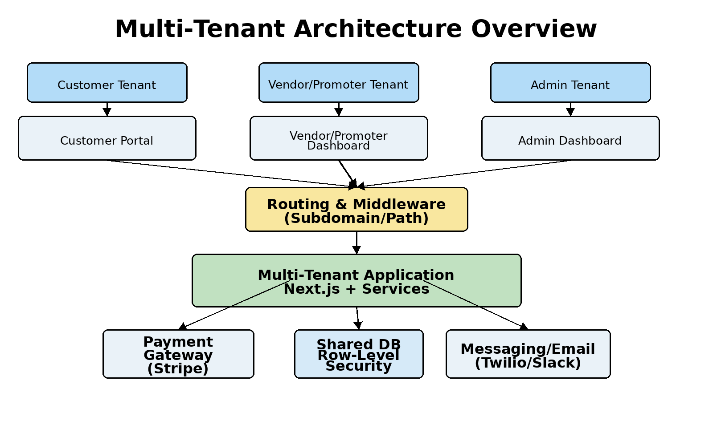

# System Architecture & Roadmap (Afrobeat Lounge Platform)

## Overview
This platform combines a **customer-first** nightlife website with a **multi-tenant** business management backend. Guests can browse galleries, see upcoming events with countdowns, reserve sections and pay deposits, and request $5 DJ shout-outs. The backend lets admins manage events, inventory, contracts, vendors/promoters, accounting, budgeting, messaging, and reporting. Promoters and vendors get their own dashboards (contracts, payments, messaging, meetings).

## Diagrams
The images below are included in this ZIP and referenced by relative paths so they render when you open this README locally.

## Tech Stack (recommended)
- **Next.js 15 + TypeScript** (App Router), **Tailwind CSS**, **shadcn/ui** for fast, accessible UI.
- **Auth.js or Clerk** for multi-tenant auth & RBAC.
- **PostgreSQL** with **Row-Level Security** (RLS) for tenant isolation; **Prisma** or **Drizzle ORM**.
- **Redis** (cache, queues). **tRPC/Route Handlers** as the BFF/API gateway.
- **Stripe** (deposits, tickets, invoices), **Cloudinary** (media), **Twilio/Email/Slack** (notifications).
- Deploy on **Vercel/AWS/Supabase**; use **CDN + Edge** for low latency.

## Key Features to Implement
- **Customer site**: galleries, services, event list with countdown, section reservations, playlists, shout-outs.
- **Promoter/Vendor portal**: contracts & signatures, payouts/receipts, messaging, scheduling.
- **Admin**: theme/site config, contract templates, inventory & vendors, budge/accounting, events, CS inbox, payroll, records, reports, audits, notifications and SLA handling.
- **Event policy**: Free entry by default; **ticketed** special events are pre-paid online to avoid lines at the door.

## Roadmap (high-level)
1. **Discovery** → user journeys, data model, tenancy style (subdomain vs path).
2. **Design** → mobile‑first, dark mode, accessible UI; component library; micro‑interactions.
3. **MVP** → customer flows (events/reservations/shout-outs), promoter onboarding, admin basics.
4. **Backoffice** → inventory, contracts, finance, CRM/CS inbox, notifications.
5. **Scale** → RUM monitoring, performance budgets, horizontal scaling, cost observability.

---

> Questions or edits? Update this README and re-export the diagrams as needed. Both images live in `public/` and are referenced with relative paths.
